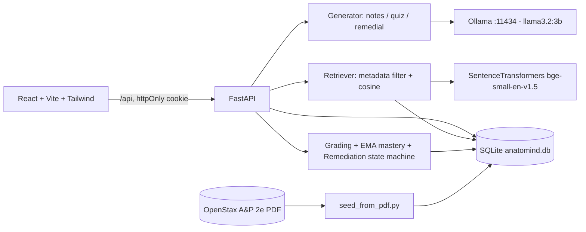

# Anatomind: Understand. Practise. Improve.

A privacy-first, local-AI learning platform for first-year MBBS students. It turns the **OpenStax *Anatomy & Physiology 2e*** textbook into
source-grounded study notes, five-question MCQ quizzes, concept-level mastery tracking and adaptive remediation. All AI runs **locally** through
Ollama (Llama 3.2 3B); no paid or cloud AI APIs are used.

> **Educational use only.** Anatomind is a study aid, not a clinical, diagnostic or treatment system.

## Key features

- **RAG over the real textbook**: the PDF is parsed into Unit → Chapter → Section → Concept, chunked, embedded (`BAAI/bge-small-en-v1.5`, 384-d) and stored in SQLite.
- **Metadata-filtered retrieval**: chunks are filtered by chapter/concept *first*, then ranked by cosine similarity.
- **Grounded notes**: structured Markdown with `[E#]` evidence markers; the retrieved excerpts (with PDF page numbers) are shown beside the notes. The model never writes the source list; the backend does.
- **Exactly five MCQs**, validated server-side (schema, distinct options, supported-by-excerpt check, no duplicates, valid source). Invalid questions are discarded and re-requested.
- **Deterministic grading** in Python. The answer key never leaves the backend until submission.
- **EMA mastery** per student per concept: `A_new = 0.6·A_latest + 0.4·A_previous` (first attempt initialises from observed performance). Good ≥ 0.80, Average 0.50–0.79, Weak < 0.50.
- **Adaptive remediation** for weak concepts: simpler re-explanation retrieved from the same concept/chapter, focused re-quiz, max **3 failed remediation quizzes** (stored in the DB), then a "consult your teacher" recommendation.
- **Secure auth**: Argon2id hashes, JWT in an httpOnly cookie, server-side logout revocation, per-user data isolation, login throttling.

## Architecture



Browser never talks to Ollama; every AI call is routed through FastAPI.

## Prerequisites

Python 3.10+, Node 18+, [Ollama](https://ollama.com/download), ~6 GB free disk, 8 GB+ RAM recommended.

## Setup

### 1. Ollama
```bash
ollama pull llama3.2:3b      # one-time download
ollama serve                 # skip if the Ollama app/service is already running
```
(Use Ollama ≥ 0.5 for JSON-schema structured output; older versions fall back to plain JSON mode automatically.)

### 2. Backend
```bash
cd backend
python -m venv .venv && source .venv/bin/activate      # Windows: .venv\Scripts\activate
pip install -r requirements.txt
cp .env.example .env
python -c "import secrets; print(secrets.token_urlsafe(48))"   # paste the output as SECRET_KEY in .env
```

### 3. Textbook dataset
The dataset is the **OpenStax Anatomy and Physiology 2e PDF** (free, CC BY 4.0): <https://openstax.org/details/books/anatomy-and-physiology-2e>.
Place it at `backend/data/anatomy-and-physiology-2e_-_WEB.pdf` (or set `PDF_PATH` in `.env`), then ingest:
```bash
python scripts/seed_from_pdf.py --dry-run     # parse only: prints chapters/sections/concepts/chunks
python scripts/seed_from_pdf.py               # full ingestion (parse ≈ 30-60 s, then embeddings)
python scripts/seed_from_pdf.py --chapters 1,19   # optional: a subset
```
The first run downloads the embedding model (~130 MB). Re-running is safe: unchanged chunks are skipped, nothing is duplicated.
For this edition the parser finds **6 units, 28 chapters, 169 sections, 736 concepts, ~2,400 chunks**.
Only numbered sections are indexed; Key Terms, Chapter Review and question sections are skipped.

### 4. Run
```bash
# terminal 1 (backend/)
uvicorn app.main:app --reload --port 8000
# terminal 2 (frontend/)
cd frontend && cp .env.example .env && npm install && npm run dev
```
Open <http://localhost:5173>. Interactive API docs: <http://localhost:8000/docs>.

## Environment variables (`backend/.env`)

| Variable | Default | Purpose |
|---|---|---|
| `SECRET_KEY` | *(required, ≥32 chars)* | JWT signing key |
| `DATABASE_URL` | `sqlite:///./anatomind.db` | SQLite location |
| `ACCESS_TOKEN_MINUTES` | `60` | Session lifetime |
| `COOKIE_SECURE` | `false` | Set `true` behind HTTPS |
| `CORS_ORIGINS` | `http://localhost:5173` | Comma-separated allowed origins |
| `OLLAMA_BASE_URL` / `OLLAMA_MODEL` | `http://localhost:11434` / `llama3.2:3b` | Local LLM |
| `OLLAMA_TIMEOUT_SECONDS` / `OLLAMA_MAX_RETRIES` | `240` / `2` | Timeout and bounded retries |
| `RETRIEVAL_TOP_K` / `MIN_CONTEXT_CHARS` | `6` / `600` | Retrieval size / minimum evidence |
| `REMEDIATION_MAX_FAILED` | `3` | Failed remediation quizzes before teacher referral |

## API routes (all under `/api`; everything except signup/login/health requires authentication)

| Area | Routes |
|---|---|
| Auth | `POST /auth/signup` · `POST /auth/login` · `POST /auth/logout` · `GET /auth/me` |
| Topics | `GET /topics/tree` · `/topics/units` · `/topics/chapters?unit_id=` · `/topics/sections?chapter_id=` · `/topics/concepts?section_id=` · `/topics/concepts/{id}` · `/topics/search?q=` |
| Learning | `POST /learning/notes` · `POST /learning/quiz` · `GET /learning/sources?chunk_id=…` |
| Quiz | `GET /quizzes/{id}` · `POST /quizzes/{id}/submit` · `GET /quizzes/{id}/results` |
| Progress | `GET /progress/summary` · `/progress/topics` · `/progress/history` |
| Remediation | `POST /remediation/start` · `GET /remediation/{concept_id}` · `POST /remediation/{concept_id}/retry` |
| Meta | `GET /health` |

Errors use one shape: `{"error": {"code": "...", "message": "...", "details": ...}}`.

## Design decisions worth knowing

- **Concepts** are the sub-headings inside a textbook section; text before the first sub-heading is the section's "Overview" concept. Very short sub-sections are merged into a neighbour so every concept has enough text to quiz on. Concepts with too little content are shown as unavailable and rejected by the API.
- **"Topics studied"** counts topics whose notes were generated. Opening notes never changes mastery; only quiz results do.
- **A remediation quiz "fails"** when mastery after the EMA update is still Weak. Counters live in `remediation_attempts` (refresh-safe). The sequence ends when mastery reaches ≥ 0.50; after the limit the student keeps full access to notes and history.
- **Quizzes** are resumed rather than regenerated if left unsubmitted (6 h); "Retry" always makes a new quiz. A quiz can be submitted once.
- **Page references** are *PDF page numbers* of the supplied file (not the printed book page numbers).
- **Telemetry** (`llm_telemetry`) stores task type, latency, model, success and validation-failure counts only: no prompts, no student data.

## Tests
```bash
pip install -r backend/requirements.txt
python -m pytest tests -q                              # backend logic + API flows (fake LLM/embedder)
ANATOMIND_TEST_PDF=/path/to/book.pdf python -m pytest tests -q   # also runs real-PDF parse/seed tests
cd frontend && npm run build                           # type-check + production build
```
Tests cover: signup/login/duplicate email, route protection, logout revocation, topic retrieval and unsupported-topic rejection, metadata-filtered cosine retrieval, exactly-five-MCQ generation and validation, malformed LLM output, deterministic grading, EMA (first/subsequent) and classification boundaries, remediation limit and retrieval scope, student isolation, persistence across logout/login, and Ollama-unavailable / model-missing handling.

## Troubleshooting

| Symptom | Fix |
|---|---|
| `SECRET_KEY must be set` | Generate one and add it to `backend/.env` |
| 503 `ollama_unavailable` | Run `ollama serve`; check `OLLAMA_BASE_URL` |
| 503 `model_not_installed` | `ollama pull llama3.2:3b` |
| 504 `llm_timeout` | Raise `OLLAMA_TIMEOUT_SECONDS`; the first request loads the model and is slow |
| 502 `generation_failed` | The 3B model produced invalid output; just retry |
| Topics page empty | Run `seed_from_pdf.py` |
| Login works but pages 401 | Use `http://localhost:5173` (Vite proxy keeps the cookie same-origin) |
| HuggingFace download blocked | Pre-download the embedding model on a connected machine and copy `~/.cache/huggingface` |

## Privacy
All inference and storage are local. Passwords are Argon2id-hashed; sessions are httpOnly cookies; progress is isolated per authenticated student.
Never commit `.env` or `anatomind.db` (both are git-ignored).

## Licence & attribution
Textbook content © OpenStax, licensed CC BY 4.0. Source: <https://openstax.org/details/books/anatomy-and-physiology-2e>.
